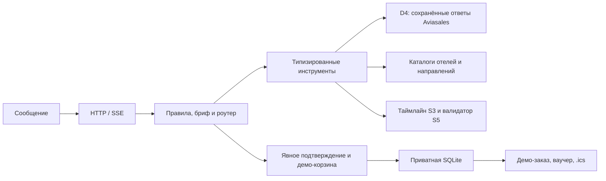

# О!дин запрос · На Мальдивы

Travel-агент команды «На Мальдивы» для Ostrovok Hackathon 2026. Из сообщения он
собирает бриф, находит направления и поездку, проверяет стыковки, объясняет выбор
и пересчитывает расходы при изменении дат. Демонстрационный путь заканчивается
корзиной, имитацией оплаты, сохраняемым заказом, HTML-ваучером и календарём `.ics`.

Эта сборка работает **без внешней модели и без ключей**: типовые сообщения
разбираются правилами, ответы составляются по проверенным фактам. Качество
свободного диалога будущей модели здесь не измеряется. Пользовательский
веб-интерфейс из main `3ba5dbc` подключён к настоящим HTTP/SSE и checkout API.
Пять последовательных автоматизированных браузерных проходов дошли до
демо-заказа и скачивания документов. Это проверка UI, не репетиция выступления.

## Интерфейс

```sh
make web          # localhost:5173, настоящий API
make web-demo     # отдельный локальный демонстрационный режим интерфейса
make web-test     # Node syntax, unit и integration проверки
```

Интерфейс из `main` сохранён; API-режим использует ответы общего сервера.
В Docker-демо используется `CHAT_MODE=api`. Для отдельного `make web` сервер
по умолчанию ожидается на 8000; подключение к Docker-демо:
`AGENT_URL=http://127.0.0.1:18083 make web`.

## Запуск офлайн-демо

Нужен запущенный Docker Desktop. Клонируйте ветку сборки для сдачи и выполните:

```bash
git clone --branch codex/submission-readiness https://github.com/ostrovok-hackathon-2026/na-maldivy.git
cd na-maldivy
make demo-up
```

Интерфейс: [localhost:5173](http://localhost:5173). API:
[localhost:18083/docs](http://localhost:18083/docs), состояние:
[localhost:18083/health](http://localhost:18083/health). Загрузка образов и зависимостей
при первой сборке требует сети; запущенный контейнер демо подключён только к
внутренней сети Docker. `.env` для демо не нужен, ключи в контейнере пустые.
Остановка: `make demo-down`. Другие порты:
`WEB_PORT=5174 AGENT_PORT=18084 make demo-up`.
Для запуска без скачивания образов заранее подготовьте
[переносимый пакет](docs/offline-package.md). Swagger `/docs` загружает элементы
интерфейса с CDN; операторская HTTP-проверка пакета работает без них.

Первый запрос использует настоящие сохранённые котировки Aviasales:

```bash
curl -N http://localhost:18083/api/chat \
  -H 'Content-Type: application/json' \
  -d '{"message":"Из Москвы в Анталью 18 ноября 2026 на неделю вдвоём"}'
```

В событии `done` придёт `session_id`; передавайте его в следующих сообщениях:
«Почему этот отель подходит семье?», «Сравни даты на 1–3 дня раньше или позже»,
«Беру первый вариант», «Да, оформляй». Последняя реплика создаёт корзину,
а не оплаченный заказ. Путешественники и явная тестовая оплата передаются через
`/api/checkout`; порядок и примеры — в [инструкции оформления](docs/demo-checkout.md).
Используйте только вымышленные данные; номера карт и CVV API не принимает.

Без Docker, после установки [uv](https://docs.astral.sh/uv/):

```bash
cd backend
uv sync --locked
cd ..
make demo-dev
```

## Что реализовано

- D1: типизированные контракты, реестр, проверка входов/выходов, JSON Schema.
- D2/D4: Aviasales через `record/replay/live`, безопасный кэш и происхождение цены;
  офлайн-снимок содержит 47 настоящих ответов на конкретные даты.
- D3/S4: единые ID 60 отелей, по 20 на Анталью, Дубай и Мальдивы; фильтры и трансферы.
- D5: 48 направлений, климатические нормы, визовая справка с датой и источниками.
- D6: поезда Петербург ↔ Москва с модельной ценой; клиент Яндекса есть, настоящий доступ не проверен.
- D7: профили 60 отелей по 1440 синтетическим текстам; числа и буквальные цитаты в ответе чата.
- D8: сравнение ±1–3 дня в том же отеле для той же группы: оба рейса, багаж,
  все ночи и сопоставимый трансфер. Подсказки — только при экономии строго больше 5%.
- S3/S5: таймлайн в местном времени и проверки ночного ожидания, заезда, правил отеля и транспорта.
- Демонстрационная корзина: SQLite, тестовый отказ/успех, идемпотентность,
  ваучер и `.ics`. Деньги не списываются, билеты не выписываются.

В Docker-демо используется `FLIGHTS_MODE=demo`: сначала настоящая запись, затем
явно подписанный мок при отсутствии подходящих данных. Строгий `aviasales`
сохраняет поведение без подмены; ошибки и дорогие существующие котировки не
скрываются моками. Сравнения D8 с моками обозначаются демонстрационными.

## Данные и ограничения

| Данные | Происхождение и границы |
|---|---|
| Авиакотировки офлайн-демо | 47 настоящих ответов Aviasales от 28.10.2026; отсутствующие подходящие рейсы в режиме demo дополнены подписанными моками. Наличие и цена покупки не подтверждены. |
| Цена группы и багаж | Расчётная модель D2; исходная цена места сохранена отдельно в `price_source`. |
| Отели | Названия и координаты OSM; цены, наличие и правила синтетические. |
| Климат и визы | Исторические нормы и датированная справка; будущие правила въезда не гарантируются. |
| Поезда | Демонстрационные расписания/цены. Настоящий Яндекс пока не проверен. |
| Отзывы | Авторские синтетические тексты, извлечение правилами. Настоящий LLM-прогон D7 не выполнялся. |
| Валюты | Исторический официальный снимок ЦБ от 24.10.2026, не коммерческий курс обмена. |

`total_rub` относится к показанным компонентам: перелёты туда-обратно с багажом,
отель и трансфер из аэропорта. Обратный трансфер, виза и прочие обязательные
доплаты не оценены. Неизвестное не превращается в ноль; неполные или критически
небезопасные варианты нельзя оформить. Ошибка провайдера не включает синтетическую подмену. Моки разрешены только
в явном демо-режиме при отсутствии подходящих данных.

Основной записанный маршрут — Анталья 18–25.11.2026, с соседними датами ±3 дня.
Мальдивы также имеют настоящие записи туда и обратно. Для DXB на пути туда API
вернул DWC: этот ответ исключается, отдельный `FLIGHTS_MODE=demo` использует
подписанный мок DXB. Обратное плечо Дубая берётся из настоящего кэша.
[Три направления и источники каждого плеча](docs/three-destination-demo.md).

## Архитектура



Сессии чата находятся в памяти процесса. Оплаченные демо-заказы сохраняются
в отдельной SQLite; это не публичный HTTP-кэш. При перезапуске законченный заказ
доступен с прежним `X-Session-ID`, незаконченный диалог нужно начать заново.
Форматы новых событий и checkout API — интеграционный вариант, не утверждённый O1.

## Проверки и доказательства

```bash
make check-fast          # Ruff и все backend-тесты
make demo-cache-check    # SHA256 и replay переносимого снимка, без ключа
make u2-eval             # 10 исходных запросов через настоящий HTTP/SSE, без сети
make submission-eval     # 50 сценариев, из них 40 наших предложенных, 49/50
make three-destination-rehearse # три направления до демо-заказа
make demo-rehearse       # 5 проходов backend до тестовой оплаты, ваучера и .ics
python3 scripts/validate_ui_rehearsal.py # проверка записанных фактических UI-прогонов
make check               # дополнительно Docker smoke
```

На 28.10.2026 проверки прошли: Ruff, **1151 тест backend**, **82 unit и 7 HTTP-тестов frontend**, Docker smoke.
Пять строгих HTTP-проходов Антальи и три прохода AYT/DXB/MLE до демо-заказа прошли; проверено сохранение заказа,
ваучера и календаря после перезапуска контейнера.
Готовый пакет из трёх экспортированных образов также прошёл
[проверку через web-прокси](eval/reports/full-ui-package-2026-10-28.json):
три направления, повторный доступ после перезапуска, совпадение файлов интерфейса
с проверенной версией и отсутствие ключей.

O2 проверяет фактические ответы и сохраняет причины ошибок. Исходный семейный
сценарий с бюджетом 150 000 ₽ несовместим с текущим набором цен: минимум
153 378 ₽. Агент корректно отказывает; исходный критерий не подгоняется под успех,
поэтому `make u2-eval` возвращает ненулевой код. Дополнительная проверка с бюджетом
170 000 ₽ отдельно подтверждает работу семейных фильтров.

[Протокол пяти UI-проходов](eval/demo-runs.json) записан отдельно от backend:
поиск → D7/D8 → серверная корзина → тестовый отказ/успех → скачивания.
Проверка подтверждает работу экранов; качество внешней модели и человеческие
репетиции выступления O3 ещё не проверены. Результаты — в [готовности к сдаче](docs/submission-readiness.md).

## Документация

- [Слайды защиты, PowerPoint](docs/defense-slides.pptx), [сценарий записи видео](docs/video-recording.md).
- [Краткий текст защиты](docs/defense-brief.md), [передача интерфейсу](docs/frontend-handoff.md).
- [Сценарий и репетиции](docs/demo.md), [оформление и ограничения](docs/demo-checkout.md).
- [Aviasales в чате](docs/chat-aviasales.md), [публичный демо-кэш](data/demo/aviasales/README.md).
- [Контракты](docs/tool-contracts.md), [устройство агента](docs/agent-guide.md).
- [Отели](docs/hotels.md), [направления](docs/destinations.md), [профили](docs/hotel-profiles.md).
- [План задач и работа с репозиторием](CONTRIBUTING.md), [атрибуция источников](data/ATTRIBUTION.md).

Черновые слайды подготовлены по проверенным фактам. Видео полного UI-прохода ещё не записано.
