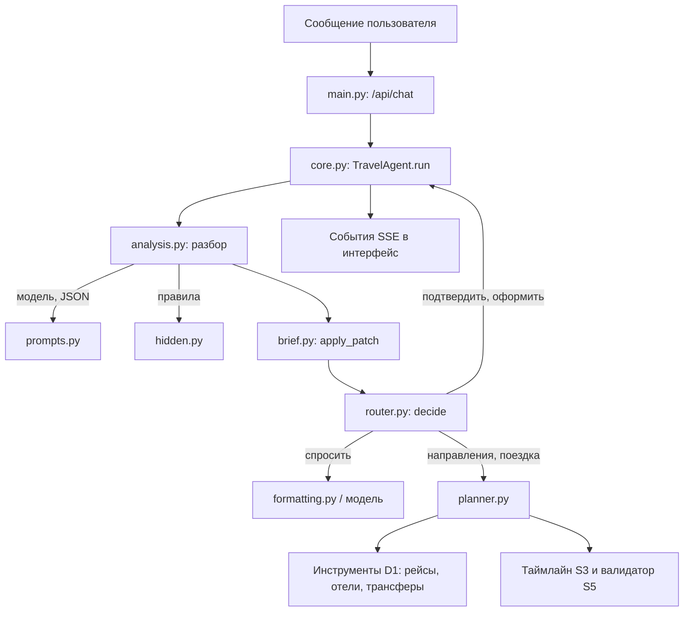

# Как устроен агент «О!дин запрос»: учебное руководство

<!-- Ссылки на код с номерами строк подставляет скрипт. Правьте docs/agent-guide.src.md, затем:
     python3 scripts/agent_guide_links.py -->

Руководство для тех, кто только начинает разбираться в AI-агентах. Мы пройдём весь путь одного сообщения
пользователя: от фразы «хочу к тёплому морю в ноябре с ребёнком» до имитации покупки. По дороге разберём,
какой файл за что отвечает, а ссылки поведут прямо к нужным строкам кода.

Код агента лежит в [backend/app/agent/](../backend/app/agent/). Задачи плана, которые он закрывает: [A2 #5](https://github.com/ostrovok-hackathon-2026/na-maldivy/issues/5)
(граф этапов и роутер) и [A4 #20](https://github.com/ostrovok-hackathon-2026/na-maldivy/issues/20)
(разбор сообщения и словарь скрытых требований).

**Как читать.** Разделы 1–3 дают общую картину, их стоит прочитать целиком. Раздел 4 идёт по шагам одного
хода, раздел 5 разбирает каждый файл. Код открывать не обязательно: каждая ссылка сопровождается объяснением.
В конце есть упражнения, чтобы закрепить материал.

Актуальные границы стоимости, работа с `null`, поиск поездов и проверка с реестром данных описаны в [заметке о совместимости](orchestrator-compatibility.md).

## Содержание

1. [Словарь: восемь понятий, без которых дальше трудно](#1-словарь)
2. [Главная идея: кто что решает](#2-главная-идея-кто-что-решает)
3. [Карта файлов](#3-карта-файлов)
4. [Путь одного сообщения](#4-путь-одного-сообщения)
5. [Файлы по очереди](#5-файлы-по-очереди)
6. [Живой пример: что видит интерфейс](#6-живой-пример-что-видит-интерфейс)
7. [Что будет, если модель ошибётся](#7-что-будет-если-модель-ошибётся)
8. [Тесты](#8-тесты)
9. [Что временно и что дальше](#9-что-временно-и-что-дальше)
10. [Упражнения](#10-упражнения)
11. [Частые вопросы](#11-частые-вопросы)

---

## 1. Словарь

**LLM (большая языковая модель).** Программа вроде ChatGPT или Claude: получает текст и продолжает его.
Хорошо понимает живую речь и пишет связный текст. Плохо считает, может уверенно выдумать факт и каждый раз
отвечает немного по-разному. У нас модель подключается через общий клиент из задачи A1:
[`base.py` → `LLMClient`](../backend/app/llm/base.py#L47-L72). У клиента два метода: `complete()` возвращает ответ целиком, `stream()` отдаёт
его по кусочкам, как печатающийся текст.

**Агент.** Программа, которая не просто отвечает, а *действует*: уточняет, ищет, сравнивает, меняет план.
Обычный чат-бот пересказывает то, что знает. Агент вызывает инструменты и доводит задачу до результата.
В задании хакатона это сказано прямо: «Если агент просто пересказывает выдачу в чате, это не решение».

**Промпт.** Текст-инструкция для модели. Например: «Ты модуль понимания сообщений. Верни JSON такого вида…».
Все наши промпты собраны в одном файле: [`prompts.py`](../backend/app/agent/prompts.py).

**Инструмент (tool).** Обычная функция в коде, которую агент может вызвать: «найди рейсы», «найди отели».
Инструменты написали коллеги из зоны «Данные и поиск» (задача D1). Список с описанием — в
[docs/tool-contracts.md](tool-contracts.md). Источник выбирается явно: заглушки,
локальные наборы D2–D8 либо записанные котировки Aviasales через D4. В текущем
демо используются настоящие исходные авиакотировки; групповые тарифы, багаж,
отели и трансферы остаются расчётными. Подробности — [chat-aviasales.md](chat-aviasales.md).

**Tool calling (вызов инструментов моделью).** Способ, которым модель «просит» вызвать функцию. Модель
не выполняет код сама. Она отвечает: «вызови `search_flights` с такими аргументами», программа вызывает
функцию и возвращает модели результат. У нас этим путём модель пользуется только в одном месте, когда
отвечает на вопросы (см. [4.7](#47-ответ-на-вопрос-модель-сама-зовёт-инструменты)). Основной поиск
запускает код. Почему так — в разделе 2.

**JSON-режим.** Просьба к модели ответить не текстом, а строго структурой JSON, например
`{"intent": "plan", "patch": {"month": 11}}`. Такой ответ программа может проверить и разобрать.

**Бриф.** Наша «анкета поездки»: откуда, куда, когда, сколько человек, бюджет, особые пожелания.
Агент заполняет её по ходу разговора. Описана в [`brief.py` → `TripBrief`](../backend/app/agent/brief.py#L59-L135).

**Сессия.** Память одного разговора: бриф, показанные варианты, на каком этапе мы находимся, история
сообщений. Без сессии агент на втором сообщении забыл бы первое. Описана в [`session.py` → `Session`](../backend/app/agent/session.py#L28-L63).

**SSE (Server-Sent Events).** Способ, которым сервер отправляет интерфейсу ответ *по частям*: сначала
«Разбираю запрос», потом «Ищу отели», потом куски текста. Поэтому пользователь видит, что агент работает,
а не смотрит на пустой экран 10 секунд.

---

## 2. Главная идея: кто что решает

Представьте турагентство с двумя сотрудниками:

- **Болтун (LLM)** отлично понимает речь клиента и красиво пишет, но иногда фантазирует и путает цифры.
- **Бухгалтер (код)** не понимает живой речи, зато никогда не ошибается в правилах и арифметике.

Наш агент *гибридный*: **Болтун понимает и пишет, Бухгалтер решает и считает.** Так устроено большинство
надёжных агентов в продакшене. Модели доверяют то, в чём она сильна, а всё, где ошибка стоит денег, делает код.

| Решение | Кто принимает | Почему |
|---|---|---|
| Что имел в виду пользователь | Модель | Живой язык: «с женой», «на недельку», «Питер» |
| Принять ли значение (бюджет −5 ₽?) | Код | Проверка правил не должна зависеть от настроения модели |
| Чего не хватает и что делать дальше | Код | Предсказуемо и проверяется тестами |
| С какими аргументами искать | Код, из брифа | Модель не сможет «подкрутить» бюджет или число гостей |
| Какой вариант лучше и почему | Код | Арифметику не доверяем модели |
| Текст ответа | Модель | Это её сильная сторона |
| Оформление покупки | Только код и только после «да» | Нельзя перескочить к покупке по ошибке |

Есть и второй принцип: **агент должен работать даже без модели.** Если ключа API нет или модель упала,
сообщения разбирают правила (регулярные выражения), а отвечают шаблоны. Качество ниже, но демо не ломается.
Эту развилку включает параметр `llm_writes_text` в [`core.py` → `TravelAgent.__init__`](../backend/app/agent/core.py#L69-L86).

---

## 3. Карта файлов

```
backend/app/
├── main.py              HTTP-сервер: адрес /api/chat, отдаёт события по SSE
└── agent/
    ├── core.py          «Начальник смены»: один ход разговора от начала до конца
    ├── analysis.py      Разбор сообщения моделью (с запасным разбором правилами)
    ├── prompts.py       Тексты инструкций для модели
    ├── hidden.py        Словарь скрытых требований и разбор правилами
    ├── brief.py         Анкета-бриф и проверка каждого поля
    ├── places.py        «Питер» → LED: названия мест в коды аэропортов
    ├── router.py        Решает, какой шаг делать дальше
    ├── planner.py       Поиск: направления, рейсы, отели, трансферы, сравнение
    ├── formatting.py    Шаблоны текстов (когда без модели или нужна точность)
    └── session.py       Память разговора
```

Как файлы связаны во время одного хода:



---

## 4. Путь одного сообщения

Пройдём один ход на примере. Пользователь уже назвал месяц и город, агент показал направления, и
пользователь пишет: **«давай первый»**.

### 4.1. Сервер принимает сообщение

Интерфейс отправляет `POST /api/chat` с телом `{"message": "давай первый", "session_id": "f002…"}`.
Обработчик [`main.py` → `create_app`](../backend/app/main.py#L28-L88) передаёт сообщение агенту и пересылает в интерфейс всё, что агент
«выкрикивает» по ходу работы. `session_id` связывает сообщения в один разговор: первый запрос приходит
без него, сервер создаёт новую сессию и сообщает её номер в последнем событии `done`.

### 4.2. Агент начинает ход

[`core.py` → `TravelAgent.run`](../backend/app/agent/core.py#L88-L115) делает три вещи:

1. Находит сессию по номеру или создаёт новую ([`session.py` → `SessionStore.get_or_create`](../backend/app/agent/session.py#L74-L81)).
2. **Копирует** сессию (`copy.deepcopy`) и работает с копией. Если посреди хода что-то сломается,
   оригинал не пострадает: пользователь получит «что-то пошло не так», но его бриф и варианты останутся.
   Только в конце успешного хода копия записывается на место оригинала.
3. Запускает сам ход и одновременно отдаёт события в интерфейс через очередь (`asyncio.Queue`).
   Поэтому «Разбираю запрос» появляется на экране сразу, а не после того, как всё посчитано.

Весь ход описан в [`core.py` → `TravelAgent._turn`](../backend/app/agent/core.py#L121-L178). Это лучшая точка входа для чтения кода: метод короткий
и показывает все шаги по порядку.

### 4.3. Разбор сообщения

[`analysis.py` → `analyze_message`](../backend/app/agent/analysis.py#L93-L143) превращает текст в [`analysis.py` → `MessageAnalysis`](../backend/app/agent/analysis.py#L28-L44). Это три вещи:

- **intent (намерение)**: что хочет человек — планировать, выбрать вариант, подтвердить, спросить,
  или сообщение вообще не о поездке. Полный список с пояснениями есть в промпте [`prompts.py` → `ANALYZE_PROMPT`](../backend/app/agent/prompts.py#L20-L65);
- **patch (патч)**: какие поля брифа поменять. Патч — это не новый бриф целиком, а *только изменения*:
  «month = 11», остальное не трогать;
- **option**: номер выбранного варианта, если человек выбирает.

Как это работает:

1. Сначала сообщение разбирают **правила** из [`hidden.py` → `extract`](../backend/app/agent/hidden.py#L159-L308). Это быстро и бесплатно.
2. Затем, если подключена модель, ей отправляется промпт, текущий бриф и последние реплики разговора,
   с просьбой вернуть JSON.
3. Ответ модели проверяется. Если это не JSON или поля не того типа, модель получает **одну** попытку
   исправиться: ей показывают её же ответ и ошибку.
4. Если и вторая попытка негодная или модель не ответила, используется разбор правилами и в интерфейс
   уходит предупреждение (`warning`).
5. Если модель ответила хорошо, к её ответу добавляются **скрытые требования**, найденные правилами
   ([`hidden.py` → `hidden_only`](../backend/app/agent/hidden.py#L120-L128)). Модель могла не заметить «с собакой», а правило заметит.

В нашем примере «давай первый» получает intent `select`, option `1`.

### 4.4. Обновление брифа

Сначала маленький, но важный шаг [`core.py` → `TravelAgent._select_destination`](../backend/app/agent/core.py#L180-L186): если на экране были
*направления*, то «давай первый» означает «хочу в первое направление». Агент подставляет его в патч:
`destination = DXB`.

Затем [`brief.py` → `apply_patch`](../backend/app/agent/brief.py#L224-L303) применяет патч к брифу. Это ключевая функция для надёжности:

- **каждое поле проверяется отдельно.** Если модель предложила бюджет −5 ₽ и месяц 11, месяц примется,
  а бюджет отклонится с причиной. Пользователь увидит: «Не смог принять: бюджет «-5» — …»;
- **у каждого поля появляется источник** (`explicit`, `inferred` или `default`, см. раздел [5.2](#52-briefpy-анкета-поездки));
- **исходный бриф не меняется**: функция возвращает новый. Так проще тестировать и откатывать.

Результат записывает [`core.py` → `TravelAgent._commit_brief`](../backend/app/agent/core.py#L188-L222). Если поменялось поле, влияющее на поиск
(город, даты, состав), показанные варианты помечаются **устаревшими** (`stale = True`). Это сигнал роутеру:
«пересобери план».

### 4.5. Решение, что делать дальше

[`router.py` → `decide`](../backend/app/agent/router.py#L53-L88) — это «Бухгалтер». Он смотрит на этап разговора, намерение и бриф и выбирает одно
действие из [`router.py` → `Action`](../backend/app/agent/router.py#L19-L28). Правила проверяются по порядку, первое подходящее побеждает:

1. Ждём подтверждения оформления, и человек сказал «да» → **создать демо-корзину** (`book`).
   Сказал «нет» → **отменить** (`cancel_confirmation`).
2. Сообщение не о поездке → **вежливо вернуть к теме** (`off_topic`).
3. Человек выбирает из показанных поездок → **показать итог и спросить «оформляем?»** (`request_confirmation`).
4. Человек задаёт вопрос, и есть варианты → **объяснить** (`explain`).
5. Не хватает обязательных полей → **задать один вопрос** (`ask`). Обязательные поля перечислены в
   [`router.py` → `REQUIRED`](../backend/app/agent/router.py#L32): месяц и город вылета. Если в пожеланиях есть ребёнок, а возраст неизвестен,
   спрашиваем и возраст ([`router.py` → `missing_fields`](../backend/app/agent/router.py#L43-L50)).
6. Направление не выбрано → **предложить направления** (`suggest_destinations`).
7. Иначе → **собрать поездку** (`search_trip`), или прокомментировать текущие варианты, если ничего не менялось.

Обратите внимание на правило 6: агент **не спрашивает** «куда хотите?», если человек не знает. Он сам
предлагает варианты с объяснением. Это прямое требование задания («Вдохновение и выбор направления»).

В нашем примере направление теперь есть, поэтому решение — `search_trip`.

### 4.6. Выполнение действия

[`core.py` → `TravelAgent._execute`](../backend/app/agent/core.py#L224-L248) — это «переключатель»: по действию вызывает нужный метод.

**Собрать поездку.** [`core.py` → `TravelAgent._search`](../backend/app/agent/core.py#L286-L314) вызывает [`planner.py` → `search_trip`](../backend/app/agent/planner.py#L376-L479), подробно о нём
в [5.6](#56-plannerpy-поиск-и-сравнение). Если до этого уже были варианты, агент запоминает лучший,
а после пересборки отправляет событие `diff` («было → стало»).

**Задать вопрос.** [`core.py` → `TravelAgent._ask`](../backend/app/agent/core.py#L254-L274) отправляет событие `question` с текстом вопроса и
кнопками быстрых ответов ([`formatting.py` → `quick_replies`](../backend/app/agent/formatting.py#L23-L31)), а модель формулирует вопрос по-человечески.

**Подтверждение и покупка.** [`core.py` → `TravelAgent._request_confirmation`](../backend/app/agent/core.py#L361-L373) показывает состав поездки
(всегда шаблоном: там цены, их нельзя пересказывать своими словами) и переводит сессию на этап
«ждём подтверждения». [`core.py` → `TravelAgent._book`](../backend/app/agent/core.py#L375-L414) ещё раз проверяет этап и в HTTP-приложении
создаёт неоплаченную демо-корзину (`checkout_pending`). Затем отдельный `/api/checkout`
принимает вымышленных путешественников и явную имитацию оплаты. Успех создаёт
сохраняемый заказ, HTML-ваучер и `.ics`; деньги не списываются.
Форматы запросов и повторы оплаты — [demo-checkout.md](demo-checkout.md).

### 4.7. Ответ на вопрос: модель сама зовёт инструменты

[`core.py` → `TravelAgent._tool_loop`](../backend/app/agent/core.py#L454-L491) — единственное место, где модель *сама* решает, какие инструменты
вызвать. Например, на вопрос «а 20 ноября есть рейсы?» модель может вызвать `search_flights`.
Это классический **агентный цикл (agent loop)**:

```
повторять до 3 раз:
    спросить модель (с описанием инструментов)
    если модель ответила текстом → готово
    если попросила инструменты → вызвать их, результаты добавить в разговор
```

Две защиты:
- лимиты: не больше 3 итераций ([`core.py` → `MAX_TOOL_STEPS`](../backend/app/agent/core.py#L56)) и 6 вызовов ([`core.py` → `MAX_TOOL_CALLS`](../backend/app/agent/core.py#L57)),
  чтобы зациклившаяся модель не крутилась бесконечно;
- состав группы (`travelers`) **всегда подменяется** значением из брифа. Даже если модель решит искать
  рейсы на 9 человек, поиск пойдёт на реальный состав. Эту защиту проверяет тест
  `test_model_cannot_change_group_in_tool_loop`.

### 4.8. Ответ пользователю

Текст ответа получается одним из двух способов:

- [`core.py` → `TravelAgent._speak`](../backend/app/agent/core.py#L520-L536) просит модель написать ответ и отправляет его кусочками (событие `delta`).
  Если модель оборвалась на середине, недописанный текст дополняется шаблоном;
- [`core.py` → `TravelAgent._say`](../backend/app/agent/core.py#L538-L540) отправляет готовый текст-шаблон из [`formatting.py`](../backend/app/agent/formatting.py).

Модели при этом передаётся **контекст**: бриф, варианты, допущения — одним JSON-сообщением
([`prompts.py` → `context_message`](../backend/app/agent/prompts.py#L96-L98)). Модель не вспоминает факты из переписки, а читает их из контекста.
В промпте [`prompts.py` → `SUMMARY_PROMPT`](../backend/app/agent/prompts.py#L71-L86) прямо сказано: «все цены и время — ровно как в options, ничего не
пересчитывай и не придумывай».

В конце хода сообщение и ответ добавляются в историю, а интерфейс получает `done` с номером сессии, этапом
и версией брифа.

---

## 5. Файлы по очереди

### 5.1. places.py: названия мест в коды

Инструменты понимают коды аэропортов (IATA): `MOW`, `LED`, `DXB`. Люди пишут «из Питера», «на Мальдивах»,
«в Турцию». [`places.py` → `to_iata`](../backend/app/agent/places.py#L57-L68) переводит одно в другое по списку основ слов [`places.py` → `_ALIASES`](../backend/app/agent/places.py#L23-L49).

Почему основы, а не полные слова: в русском много падежей («Москва», «из Москвы», «в Москве»),
а основа «москв» ловит их все. Тонкость: основа «мале» (город Мале на Мальдивах) требует конца слова,
иначе «маленький ребёнок» превратился бы в поездку на Мальдивы. Такие ошибки и ловят тесты (`test_places`).

### 5.2. brief.py: анкета поездки

[`brief.py` → `TripBrief`](../backend/app/agent/brief.py#L59-L135) — бриф. Это *Pydantic-модель*, то есть класс, который сам проверяет свои поля:
месяц от 1 до 12, бюджет больше нуля, возраст ребёнка от 0 до 17. Несколько проверок написаны отдельно:

- [`brief.py` → `TripBrief._known_origin`](../backend/app/agent/brief.py#L86-L94) и [`brief.py` → `TripBrief._known_destination`](../backend/app/agent/brief.py#L96-L106) не пропускают места,
  которых нет в каталоге, и объясняют почему: «направления «Марс» нет в демо-каталоге. Есть: …»;
- [`brief.py` → `TripBrief._date_sets_month`](../backend/app/agent/brief.py#L115-L127): конкретная дата задаёт месяц и год;
  противоречивые значения отклоняются. `year` также сохраняет год запроса без точного дня,
  а `late_departure` — явно запрошенный вечерний вылет.

[`brief.py` → `BriefPatch`](../backend/app/agent/brief.py#L138-L176) — предлагаемые изменения. Поле `None` значит «в этом сообщении об этом не говорили».
Кроме полей брифа, в патче есть служебные списки:
- `needs_add` и `needs_remove` — добавить или убрать скрытые требования;
- `cleared` — явно снятые ограничения («бюджет не важен» → `["budget_rub"]`);
- `inferred` — какие поля выведены, а не сказаны прямо.

**Источники полей** — важная идея задачи A4. Каждое заполненное поле помечено:

| Источник | Значение | Пример |
|---|---|---|
| `explicit` | пользователь сказал прямо | «в ноябре» → месяц 11 |
| `inferred` | агент вывел из сказанного | «с женой» → 2 взрослых |
| `default` | агент допустил сам, ничего не услышав | срок не назван → 7 ночей |

Зачем: интерфейс (задача U2) показывает плашки разного вида, и пользователь видит, где агент *догадался*.
Догадку можно поправить одним нажатием. Это и есть «пользователь должен понимать логику агента и мочь её
поправить» из задания.

[`brief.py` → `apply_patch`](../backend/app/agent/brief.py#L224-L303) применяет патч по шагам:
1. Сбрасывает снятые ограничения (`cleared`).
2. Если пришла новая дата — берёт из неё месяц и год, включая переход через Новый год.
   Если изменился только месяц или год, несовместимая старая дата сбрасывается.
3. Для каждого поля пробует собрать бриф с новым значением. Не получилось — поле попадает в `rejected`
   с понятной причиной, остальные поля применяются.
4. Обновляет список скрытых требований.
5. Сравнивает старый и новый бриф и для каждого изменения записывает источник.

[`brief.py` → `SEARCH_FIELDS`](../backend/app/agent/brief.py#L56) — поля, изменение которых делает найденные варианты устаревшими. «Настроение
поездки» (`mood`) в него не входит: оно меняет текст, но не поиск.

[`brief.py` → `merge_patches`](../backend/app/agent/brief.py#L206-L217) объединяет два патча, например от модели и от правил. Значения первого важнее,
второй заполняет пропуски.

### 5.3. hidden.py: словарь скрытых требований

Человек пишет «с ребёнком», а подразумевает куда больше: семейный отель (не «только для взрослых»),
детское кресло в такси, перелёт покороче. Возраст ребёнка влияет и на цену, и на правила отеля.
Эти связи хранятся *явно*, в коде, а не только в голове модели:

- [`hidden.py` → `NEEDS`](../backend/app/agent/hidden.py#L32-L44) — сам словарь: 11 требований, у каждого понятное название и описание того,
  *что агент из-за него делает иначе*. Описание уходит и в промпт, и в интерфейс;
- [`hidden.py` → `RULES`](../backend/app/agent/hidden.py#L55-L72) — по каким словам распознаётся каждое требование и какие поля брифа из него
  выводятся. Например, «с собакой» → `pets = 1`, «к морю» → `min_water_temperature_c = 24`.

Где требования используются дальше:

| Требование | Где влияет |
|---|---|
| `child` | роутер спрашивает возраст; отели «только для взрослых» отсекаются ([`planner.py` → `_hotel_fits`](../backend/app/agent/planner.py#L221-L231)); валидатор S5 проверяет детское кресло |
| `pets` | отели, где животные запрещены, отсекаются; в рисках — «уточнить у отеля», если неизвестно |
| `sea`, `warm` | направления с холодной водой не предлагаются; в объяснении — температура воды |
| `budget_low` | цена весит вдвое больше в оценке вариантов ([`planner.py` → `_score`](../backend/app/agent/planner.py#L300-L315)) |
| `short_flight` | направления сортируются по времени перелёта |
| `romantic`, `quiet` | отели «только для взрослых» выше в списке |
| `late_arrival` | отели без круглосуточного ресепшена ниже |
| `flexible` | ищутся только тарифы с бесплатной отменой |

Ещё в файле есть **разбор правилами** ([`hidden.py` → `extract`](../backend/app/agent/hidden.py#L159-L308)): регулярные выражения, которые вытаскивают
город, месяц или дату, срок, бюджет, состав группы. Главный принцип — *не угадывать*: если в тексте нет
города вылета, в патче его тоже нет, и агент спросит. Пара тонкостей, которые стоит посмотреть в коде:
- «5 дней» превращается в 4 ночи и помечается как `inferred`: это вывод, а не слова пользователя;
- «до 5 часов» не считается бюджетом: суммы меньше 5000 ₽ отбрасываются.

[`hidden.py` → `relative`](../backend/app/agent/hidden.py#L136-L156) понимает **относительные изменения**: «на два дня позже», «на 3 дня дольше»,
«бюджет меньше на 20 тысяч». Они считаются от текущего брифа. Это основа требования «пересборка плана».

### 5.4. prompts.py: инструкции для модели

Каждый шаг получает свой короткий промпт, а не один огромный «ты — турагент, делай всё». Так модели
проще, а нам легче найти, какой шаг ошибся.

| Промпт | Где используется | Что просит |
|---|---|---|
| [`prompts.py` → `ANALYZE_PROMPT`](../backend/app/agent/prompts.py#L20-L65) | разбор | вернуть JSON с намерением и патчем, ничего не придумывать |
| [`prompts.py` → `ASK_PROMPT`](../backend/app/agent/prompts.py#L67-L69) | уточнение | задать один вопрос и назвать сделанные допущения |
| [`prompts.py` → `SUMMARY_PROMPT`](../backend/app/agent/prompts.py#L71-L86) | после поиска | по каждому варианту: почему подходит, чем жертвуем, риски, цены как в данных |
| [`prompts.py` → `EXPLAIN_PROMPT`](../backend/app/agent/prompts.py#L88-L90) | вопрос | ответить по данным, при нужде вызвать инструмент |
| [`prompts.py` → `OFF_TOPIC_PROMPT`](../backend/app/agent/prompts.py#L92-L93) | не о поездке | вежливо вернуть к теме |

Обратите внимание: списки мест и скрытых требований подставляются в [`prompts.py` → `ANALYZE_PROMPT`](../backend/app/agent/prompts.py#L20-L65) прямо из
[`places.py` → `PLACE_NAMES`](../backend/app/agent/places.py#L12-L19) и [`hidden.py` → `NEEDS`](../backend/app/agent/hidden.py#L32-L44). Добавили требование в словарь — модель узнает о нём
автоматически.

**Промпт — это просьба, код — гарантия.** Все критичные правила из промптов продублированы в коде:
модель просят не менять бюджет, но аргументы поиска всё равно собирает код.

### 5.5. analysis.py: разбор сообщения

Подробно разобран в [4.3](#43-разбор-сообщения). Что стоит посмотреть в коде:

- [`analysis.py` → `MessageAnalysis._known_codes`](../backend/app/agent/analysis.py#L36-L44): модель не может придумать новое требование или
  несуществующее поле, неизвестные коды просто выбрасываются;
- [`analysis.py` → `rules_intent`](../backend/app/agent/analysis.py#L69-L90): как определить намерение без модели. Только по явным сигналам: «да» в
  начале фразы на этапе подтверждения, «второй вариант», знак вопроса. Если ничего не подошло — `plan`.

### 5.6. planner.py: поиск и сравнение

Самый большой файл: здесь агент «действует». Аргументы для инструментов везде собираются **из брифа**,
модель в этом не участвует.

**Вдохновение** — [`planner.py` → `suggest`](../backend/app/agent/planner.py#L78-L185). Вызывает инструмент `suggest_destinations` и для каждого
направления готовит три списка: `why` (почему подходит), `tradeoffs` (чем жертвуем), `risks` (риски).
Если в бюджет не влезло ничего, ищет ещё раз без бюджета и честно пишет: «В бюджет ничего не помещается,
показываю ближайшие варианты дороже». Пустой ответ «ничего не найдено» хуже, чем честный компромисс.

**Сборка поездки** — [`planner.py` → `search_trip`](../backend/app/agent/planner.py#L376-L479). Пошагово:

1. **Дата.** Если её не назвали, [`planner.py` → `_pick_start_date`](../backend/app/agent/planner.py#L193-L218) смотрит календарь цен и берёт самый
   день с минимальной доступной ценой в одну сторону в указанном году. Это *допущение*;
   оно не доказывает экономию всей поездки.
2. **Рейсы туда.**
3. **Для каждой даты прилёта:** отели и рейсы обратно. Учтён ночной рейс: если прилетаем на следующий
   день, заселение и обратный рейс считаются от даты прилёта.
4. **Фильтр отелей** ([`planner.py` → `_hotel_fits`](../backend/app/agent/planner.py#L221-L231)): с ребёнком не берём «только для взрослых», с собакой —
   отели, где животные точно запрещены. Важно: *неизвестное* (`null`) не отсекается — это риск, а не запрет.
5. **Трансфер** из аэропорта в отель ([`planner.py` → `_transfer`](../backend/app/agent/planner.py#L482-L499)), через 45 минут после посадки
   (паспортный контроль и багаж).
6. **Проверка стыковок** ([`planner.py` → `_validate`](../backend/app/agent/planner.py#L502-L517)): строится таймлайн поездки (код коллег, задача S3)
   и прогоняется валидатор (задача S5). Он находит проблемы вроде «приезжаете в 3 ночи, а ресепшен закрыт
   в 22:00» или «неизвестно, будет ли детское кресло».
7. **Оценка** ([`planner.py` → `_score`](../backend/app/agent/planner.py#L300-L315)): итоговая цена плюс «штрафы». Критичная проблема стыковки стоит как
   30 000 ₽ переплаты ([`planner.py` → `PENALTY`](../backend/app/agent/planner.py#L34)). Выход за бюджет штрафуется вдвойне. Отель «только для
   взрослых» для романтической поездки получает бонус. **Меньше — лучше.**
8. **Выбор трёх разных отелей** ([`planner.py` → `_pick_packages`](../backend/app/agent/planner.py#L520-L645)): «Оптимальный» (лучшая оценка),
   «Подешевле» и «Комфорт» (больше звёзд и выше рейтинг). Самый дешёвый из показанных получает пометку
   «дешевле всех», чтобы метка всегда говорила правду.
9. **Объяснение** ([`planner.py` → `_explain`](../backend/app/agent/planner.py#L318-L373)): по каждому варианту три списка фактов. Только из данных —
   никаких «уютных номеров», если об этом нигде не сказано.

Каждый вариант на выходе — словарь с рейсами, отелем, трансфером, итоговой ценой, найденными проблемами
и объяснением. Его получает и модель (чтобы написать текст), и интерфейс (чтобы нарисовать карточку).

> Оценка в `_score` временная и намеренно простая. Полноценное ранжирование с весами и
> Парето-оптимальностью — задача R2 ([#12](https://github.com/ostrovok-hackathon-2026/na-maldivy/issues/12)).

### 5.7. formatting.py: шаблоны

Тексты, которые пишет код, а не модель. Используются в трёх случаях:
- модель не подключена или упала;
- нужна точность: подтверждение покупки ([`formatting.py` → `confirmation`](../backend/app/agent/formatting.py#L176-L206)) и чек
  ([`formatting.py` → `booked`](../backend/app/agent/formatting.py#L209-L214)) всегда шаблонные;
- короткие служебные ответы: «какой вариант выбираете?».

Мелочи, которые делают текст человеческим: [`planner.py` → `plural`](../backend/app/agent/planner.py#L60-L63) склоняет числа («1 ночь», «4 ночи»,
«7 ночей»), [`planner.py` → `rub`](../backend/app/agent/planner.py#L56-L57) пишет «151 600 ₽», [`formatting.py` → `when`](../backend/app/agent/formatting.py#L159-L161) превращает
`2026-11-07T09:00:00+03:00` в «07.11 09:00».

### 5.8. session.py: память разговора

[`session.py` → `Session`](../backend/app/agent/session.py#L28-L63) хранит:
- `brief` и `sources` — бриф и источники полей;
- `stage` — этап разговора ([`session.py` → `Stage`](../backend/app/agent/session.py#L18-L25)): сбор → направления показаны → поездки показаны →
  ждём подтверждения → демо-корзина создана → тестовая оплата выполнена;
- `destinations` и `packages` — что показано на экране. По ним понимаем «давай второй»;
- `stale` — показанное устарело, нужно пересобрать;
- `version` — номер версии брифа, растёт при каждом изменении (пригодится для «было → стало»);
- `history` — последние реплики. Модель видит только 8 последних ([`session.py` → `HISTORY_WINDOW`](../backend/app/agent/session.py#L15)):
  всё важное и так лежит в брифе, а длинная история дорогая и путает модель.

[`session.py` → `SessionStore`](../backend/app/agent/session.py#L66-L84) держит сессии в памяти сервера. Для демо этого достаточно, но после
перезапуска сервера разговоры теряются. Оплаченные демо-заказы отдельно сохраняются в
приватной SQLite и доступны по номеру и заголовку `X-Session-ID`; это не восстановление
всей истории чата. В снимке сессии остаётся сводка заказа без анкет путешественников.

### 5.9. core.py: начальник смены

Связывает всё вместе. Основные методы уже разобраны в разделе 4. Ещё один, стоит его знать:

[`core.py` → `TravelAgent._adopt_assumptions`](../backend/app/agent/core.py#L316-L330) — после сборки поездки дата и срок, которые выбрал
планировщик, записываются в бриф с источником `default`. Без этого «а если на два дня позже?» не от чего
было бы считать: пользователь дату не называл.

[`core.py` → `TravelAgent._caller`](../backend/app/agent/core.py#L420-L452) — обёртка над инструментами. Каждый вызов отправляет в интерфейс события
`tool_call` и `tool_result`, а ошибки (неподдерживаемый маршрут, неверные аргументы) не роняют ход:
инструмент просто возвращает «ничего», и поиск продолжается с тем, что есть.

**Все события**, которые получает интерфейс, перечислены в начале файла [`core.py`](../backend/app/agent/core.py):

| Событие | Когда | Что внутри |
|---|---|---|
| `status` | агент начал шаг | «Разбираю запрос», «Ищу отели» |
| `brief` | бриф изменился | бриф, источники, что поменялось, что отклонено, скрытые требования |
| `question` | агент уточняет | поле, текст вопроса, кнопки быстрых ответов |
| `tool_call` / `tool_result` | вызов инструмента | имя и аргументы / успех и число результатов |
| `options` | найдены варианты | карточки направлений или поездок, допущения |
| `diff` | план пересобран | было → стало |
| `booking` | создана демо-корзина | `cart_id`, статус, составная сумма, `paid=false`; это ещё не оплаченный заказ |
| `date_savings` | вопрос о сдвиге дат | сравнение того же отеля, группы и срока, границы суммы, экономия строго больше 5%; даты не изменяются |
| `hotel_profile` | вопрос об отзывах | числа D7, буквальные цитаты с ID, синтетическое происхождение и метод извлечения |
| `destination_info` | вопрос об источнике или визах | датированная справка, URL, срок действия и неизвестная полная цена |
| `data_integrity` | просьба выдумать цены/наличие | отказ от выдумки без изменения состояния |
| `warning` | агент обошёл проблему | «Модель не ответила, разбираю правилами» |
| `delta` | текст ответа | кусочек текста |
| `done` / `error` | конец хода | номер сессии, этап, версия / сообщение об ошибке |

### 5.10. main.py: HTTP-сервер

[`main.py` → `create_app`](../backend/app/main.py#L28-L88) создаёт приложение с адресами:
- `POST /api/chat` — главный: сообщение → поток событий;
- `GET /api/session/{id}` — посмотреть текущий бриф и этап. Удобно для отладки;
- `DELETE /api/session/{id}` — начать разговор заново.

Также подключён `/api/checkout`: создание/чтение корзины, анкеты вымышленных
путешественников, тестовая оплата, чтение сохраняемого заказа и скачивание ваучера/календаря.
Цены и состав берутся с сервера; версия или выбор изменились — старая корзина не оплачивается.
Записи checkout используют ту же блокировку сессии, что и ход чата. Форматы —
[demo-checkout.md](demo-checkout.md); они пока не объявлены согласованным контрактом O1.

Здесь же решается режим: при `LLM_PROVIDER=fake` (нет ключа) агент работает на правилах и шаблонах.

---

## 6. Живой пример: что видит интерфейс

Это исторический вывод первой версии агента без модели; события сокращены.
Текущий проверенный HTTP-сценарий с D4, D7, D8 и отдельной демо-оплатой находится
в [demo.md](demo.md). Старые суммы и переход `booking` ниже не описывают текущую сборку.

**Сообщение 1:** «хочу к тёплому морю в ноябре, недорого, с ребёнком»

```
status:   Разбираю запрос
brief:    month=11 (explicit), adults=2 (inferred), min_water_temperature_c=24 (inferred),
          needs=[child, sea, warm, budget_low]
question: field=origin, «Понял: в ноябре, 2 взрослых + ребёнок. Откуда полетите?»,
          кнопки [Из Москвы] [Из Санкт-Петербурга]
done:     stage=collecting, version=1
```

Агент понял месяц и скрытые требования, сам вывел «двое взрослых» и честно пометил это как догадку.
Не хватает города вылета — один вопрос и кнопки.

**Сообщение 2:** «из Москвы» → вопрос о возрасте ребёнка (кнопки «До 2 лет», «3 года», «7 лет», «12 лет»).

**Сообщение 3:** «ребёнку 5 лет»

```
tool_call:   suggest_destinations → 2 результата
options:     Дубай — около 275 100 ₽, вода +27 °C, виза не нужна; минус: перелёт 5 ч 30 мин
             Мальдивы — около 455 100 ₽, вода +28 °C; минус: перелёт 9 ч
             допущение: считаю на 7 ночей
done:        stage=destinations_shown
```

Анталью агент не предложил: в ноябре там вода прохладнее 24 °C, а человек хотел тёплое море.

**Сообщение 4:** «давай первый»

```
tool_call:  price_calendar → 30 дней
tool_call:  search_flights, search_hotels, search_flights, get_transfer × 3 … (по датам прилёта)
brief:      start_date=2026-11-07 (default), nights=7 (default)
options:    1. Оптимальный · дешевле всех: Demo DXB budget — 234 980 ₽
               почему: прямые рейсы; трансфер 5 мин за 580 ₽
               чем жертвуем: отель без возврата; багаж отдельно 12 000 ₽
               риски: неизвестно, будет ли детское кресло в такси
            2. Комфорт: Demo DXB premium — …
            допущение: вылет 07.11 — самый дешёвый день месяца
```

Риск про детское кресло нашёл валидатор S5: это работа скрытого требования `child`.

**Сообщение 5:** «а если на два дня позже?»

```
brief:  start_date=2026-11-09   ← одно поле, остальное на месте
diff:   было Demo DXB budget 234 980 ₽ (07–14.11) → стало 237 980 ₽ (09–16.11)
```

Агент не начал с нуля: поменял одну дату и пересобрал.

**Сообщение 6:** «беру второй» → состав поездки по пунктам, итог, «Оформляем? Это имитация».

**Сообщение 7:** «да» → `booking: DEMO-04ADD893, 355 600 ₽, is_simulated=true`.

Повторить этот пример можно самостоятельно, см. [раздел 8](#8-тесты).

---

## 7. Что будет, если модель ошибётся

Хороший агент проектируют, заранее предполагая, что модель *будет* ошибаться. Вот что у нас предусмотрено:

| Что пошло не так | Что делает агент | Где в коде |
|---|---|---|
| Модель вернула не JSON | одна попытка исправиться, потом разбор правилами | [`analysis.py` → `analyze_message`](../backend/app/agent/analysis.py#L93-L143) |
| Модель не ответила (сеть, таймаут) | разбор правилами, текст шаблоном, `warning` в интерфейс | [`analysis.py` → `analyze_message`](../backend/app/agent/analysis.py#L93-L143), [`core.py` → `TravelAgent._speak`](../backend/app/agent/core.py#L520-L536) |
| Модель предложила бюджет −5 ₽ или город «Марс» | поле отклонено с причиной, остальные приняты | [`brief.py` → `apply_patch`](../backend/app/agent/brief.py#L224-L303) |
| Модель придумала несуществующее требование | выброшено | [`analysis.py` → `MessageAnalysis._known_codes`](../backend/app/agent/analysis.py#L36-L44) |
| Модель забыла «с собакой» | правило добавит | [`hidden.py` → `hidden_only`](../backend/app/agent/hidden.py#L120-L128) |
| Модель хочет искать на другой состав группы | состав подменяется из брифа | [`core.py` → `TravelAgent._tool_loop`](../backend/app/agent/core.py#L454-L491) |
| Модель зациклилась на инструментах | лимит 3 итерации и 6 вызовов | [`core.py` → `MAX_TOOL_STEPS`](../backend/app/agent/core.py#L56) |
| Модель «поняла» покупку без подтверждения | покупка возможна только с этапа «ждём подтверждения» | [`router.py` → `decide`](../backend/app/agent/router.py#L53-L88), [`core.py` → `TravelAgent._book`](../backend/app/agent/core.py#L375-L414) |
| Модель выдумала цену в тексте | промпт запрещает; карточки и чек всегда из данных | [`prompts.py` → `SUMMARY_PROMPT`](../backend/app/agent/prompts.py#L71-L86), [`formatting.py` → `confirmation`](../backend/app/agent/formatting.py#L176-L206) |
| Инструмент упал | ход продолжается без этого результата | [`core.py` → `TravelAgent._caller`](../backend/app/agent/core.py#L420-L452) |
| Упало что угодно посреди хода | сессия не меняется, пользователь видит `error` | [`core.py` → `TravelAgent.run`](../backend/app/agent/core.py#L88-L115) |

---

## 8. Тесты

**Тест** — маленькая программа, которая проверяет, что код ведёт себя как задумано. Например: «если
написать „с собакой“, в брифе должно появиться pets = 1». Тесты запускаются за секунду и ловят случайные
поломки: поменяли регулярное выражение для бюджета — тест сразу скажет, если «до 5 часов» снова стало
бюджетом.

Тесты агента:

| Файл | Что проверяет |
|---|---|
| [test_agent_hidden.py](../backend/tests/test_agent_hidden.py) | скрытые требования, разбор правилами, относительные изменения, названия мест |
| [test_agent_brief.py](../backend/tests/test_agent_brief.py) | проверку полей, источники, сброс даты при смене месяца, слияние патчей |
| [test_agent_flow.py](../backend/tests/test_agent_flow.py) | весь путь до покупки, пересборку, защиту от ошибок модели, откат при падении |
| [test_api.py](../backend/tests/test_api.py) | HTTP: сессии, поток событий, работу при упавшей модели |

Модель в тестах не настоящая: `FakeLLMClient` возвращает заранее заготовленные ответы. Поэтому тестам
не нужен интернет и ключ, а результат всегда одинаковый. Посмотрите, например,
`test_invalid_model_json_falls_back_to_rules` в [test_agent_flow.py](../backend/tests/test_agent_flow.py):
«модель» дважды отвечает мусором, и тест проверяет, что агент всё равно понял месяц.

Запуск всех проверок из корня репозитория:

```bash
make check-fast      # линтер и тесты, без Docker
```

Запуск только тестов агента с подробным выводом:

```bash
cd backend
uv run pytest tests/test_agent_flow.py -v
```

Поговорить с агентом вживую (без ключа он работает на правилах):

```bash
make up                                  # запустить сервер в Docker
curl -N localhost:8000/api/chat -H 'Content-Type: application/json' \
     -d '{"message": "хочу к тёплому морю в ноябре с ребёнком"}'
```

В последнем событии `done` будет `session_id`: добавьте его в следующий запрос, чтобы продолжить разговор.

---

## 9. Что временно и что дальше

| Что | Сейчас | Кто доделывает |
|---|---|---|
| Схема брифа и сессии | временная, в `brief.py` и `session.py` | R1 [#4](https://github.com/ostrovok-hackathon-2026/na-maldivy/issues/4): общий TripState, поля переносятся один к одному |
| Ранжирование | простая оценка в `_score` | R2 [#12](https://github.com/ostrovok-hackathon-2026/na-maldivy/issues/12) |
| Политика уточнений | два обязательных поля и возраст ребёнка | A5 [#25](https://github.com/ostrovok-hackathon-2026/na-maldivy/issues/25) |
| Выбор модели | любая OpenAI-совместимая, задаётся в `.env` | A3 [#7](https://github.com/ostrovok-hackathon-2026/na-maldivy/issues/7): сравнить 2–3 модели на 30 запросах |
| Данные | D5 с источниками, 60 отелей D3/S4, котировки Aviasales/D4; остальные цены и отзывы модельные | Проверка Яндекс и настоящий LLM-прогон D7 ещё нужны |
| Хранение | чат в памяти; оплаченные демо-заказы в приватной SQLite | Общее долговечное состояние диалога отдельно |
| Формат событий | временный | O1 [#3](https://github.com/ostrovok-hackathon-2026/na-maldivy/issues/3) |

На защите важно честно сказать, что данные демонстрационные: этого прямо требует задание. Агент сам
пишет об этом в каждом ответе с вариантами.

---

## 10. Упражнения

Лучший способ разобраться — поменять что-нибудь и посмотреть, что изменилось. Каждое упражнение
заканчивается запуском тестов: если они прошли, вы ничего не сломали.

**Упражнение 1. Новое скрытое требование.** Добавьте требование «с инвалидной коляской».
1. В [`hidden.py` → `NEEDS`](../backend/app/agent/hidden.py#L32-L44) добавьте строку `"accessible": Need("доступная среда", "отели без лестниц, трансфер с подъёмником")`.
2. В [`hidden.py` → `RULES`](../backend/app/agent/hidden.py#L55-L72) добавьте правило: `Rule("accessible", r"коляск|инвалид|доступн\w* сред")`.
3. В [test_agent_hidden.py](../backend/tests/test_agent_hidden.py) добавьте в список `test_detects_hidden_needs`
   пару `("едем с бабушкой на коляске", {"accessible", "short_transfer"})`.
4. Запустите тесты. Обратите внимание: в промпт модели новое требование попадёт само (см. [5.4](#54-promptspy-инструкции-для-модели)).

**Упражнение 2. Меньше вопросов.** Сделайте так, чтобы агент не спрашивал город вылета, а считал его
Москвой по умолчанию. Подсказка: уберите `"origin"` из [`router.py` → `REQUIRED`](../backend/app/agent/router.py#L32) и подумайте, где задать
допущение (посмотрите, как это сделано для срока поездки в [`planner.py` → `search_trip`](../backend/app/agent/planner.py#L376-L479)). Какие тесты упадут
и почему? Это хороший повод обсудить с командой: что лучше — лишний вопрос или неверная догадка?

**Упражнение 3. Прочитать ход.** Откройте [`core.py` → `TravelAgent._turn`](../backend/app/agent/core.py#L121-L178) и по разделу 4 подпишите
карандашом, какой строке соответствует каждый шаг: разбор, бриф, роутер, действие, история.

**Упражнение 4. Сломать специально.** В [`places.py` → `_ALIASES`](../backend/app/agent/places.py#L23-L49) замените `(r"мале\b", "MLE")` на
`("мале", "MLE")`, то есть уберите требование конца слова, и запустите тесты. Упадёт `test_places`:
слово «маленький» теперь превращается в Мальдивы, и фраза «с маленьким ребёнком» отправила бы семью
не туда. Верните как было. Так тесты защищают от случайных правок.

---

## 11. Частые вопросы

**Почему поиск запускает код, а не модель через tool calling? Разве агент — это не когда модель сама
вызывает инструменты?**
Можно и так, и в [`core.py` → `TravelAgent._tool_loop`](../backend/app/agent/core.py#L454-L491) модель действительно вызывает инструменты сама.
Но для основного поиска мы знаем точную последовательность: календарь → рейсы → отели → трансфер →
проверка. Отдавать её модели — значит рисковать, что она пропустит трансфер или поищет не на те даты.
Код делает это одинаково каждый раз и проверяется тестами. Модель решает там, где нужна гибкость:
понимание речи и ответы на неожиданные вопросы.

**Зачем разбор правилами, если есть модель?**
Две причины. Первая — надёжность: модель может пропустить «с собакой», а правило нет. Вторая — агент
работает без ключа и без интернета. Это удобно для разработки интерфейса и спасает демо, если у
провайдера модели сбой.

**Что такое `async` и `await` в коде?**
Способ делать несколько дел одновременно, не дожидаясь каждого. Пока модель думает над ответом, сервер
может отправлять в интерфейс уже готовые события. Для понимания логики агента их можно мысленно
пропускать: `await f()` значит просто «вызови f и дождись результата».

**Почему вариантов три, а не десять?**
Задание просит помочь выбрать, а не вывалить выдачу. Три разных по характеру варианта («оптимальный»,
«подешевле», «комфорт») с объяснением, чем жертвуем, помогают решить быстрее, чем длинный список.

**Где поменять модель?**
В файле `.env` в корне репозитория: `LLM_PROVIDER=openai`, адрес, ключ и название модели. Код менять
не нужно. Подробнее — в [README](../README.md).
