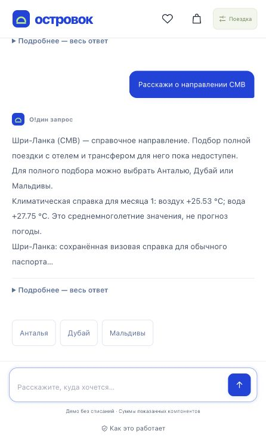

# Выбор карточек направлений D5

Исправление проверено на версии `7cefd7ea1d338782953324befdd207e814820cca`.
Карточки отправляют IATA-код и заранее различают полный демо-подбор для AYT/DXB/MLE
и справку для остальных направлений. Имена и алиасы широкого D5-каталога больше
не зависят от узкого словаря модели или первых трёх букв названия.

Проверки: 1978 backend, 278 frontend и 11 gateway-тестов; линтер; стандартная
Docker-сборка с тремя направлениями, демо-оплатой, документами и перезапуском.
Отдельно проверены точные карточки, склонение Шри-Ланки, многословные названия,
смена направления, ответ о городе вылета, неоднозначность и последняя явная коррекция.

В локальном браузере отправлен запрос о тёплом море в январе 2027 из Москвы
для двух взрослых на семь ночей. Шри-Ланка появилась со статусом «Только справка»;
нажатие «О направлении» открыло факты о CMB, без ошибки распознавания и старых
карточек отелей. Это проверка отдельного локального интерфейса с шаблонными ответами.

На закрытом сайте владельца оба варианта команды — старое название и новый IATA —
прошли через HTTPS за 15,793 с суммарно, два вызова действующей быстрой модели.
Поиск поставщиков, оформление и оплата этими запросами не запускались. Байт-в-байт
сверена отдаваемая версия интерфейса. Все восемь прежних демо-заказов, шестнадцать
документов и прежние маркеры принятых сообщений сохранились.

[Обезличенные результаты](report.json). Секреты, реальные персональные данные,
идентификаторы сессий и закрытые резервные копии в отчёт не включены.
Справочные климатические и визовые сведения остаются сохранённым срезом;
исправление не добавляет подтверждённые отели или наличие за пределами трёх
демо-направлений и не завершает требование о демо-видео.
