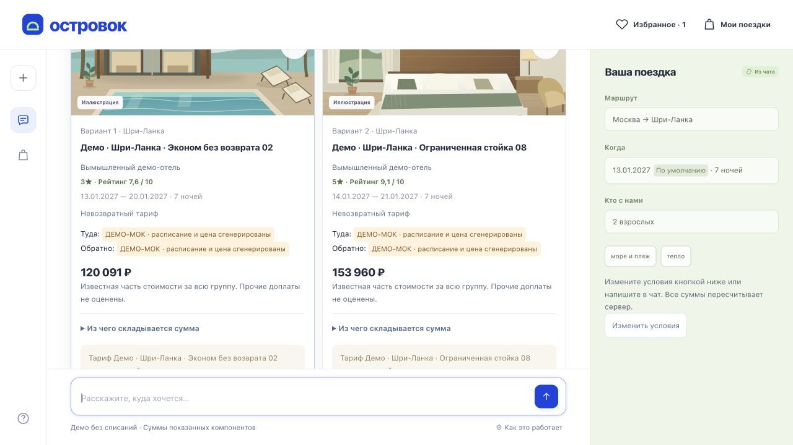

# Полнота демо-данных и связность сценариев — 29.10.2026

Код проверенного и установленного релиза: `a2a1ed4385fc0453644e527cf80b2d0267f1d88b`.
Отчёт добавлен следующим коммитом без изменения этого кода. Проверки ниже относятся
к зафиксированному релизу; параллельные незакоммиченные изменения рабочей папки
в него не включены.

## Что доступно

В явном режиме `FLIGHTS_MODE=demo` все **48 направлений D5** поддерживают подбор
перелёта туда и обратно, отеля и трансфера. Начальный дефект воспроизведён и
устранён: предложение Шри-Ланки → «Подобрать поездку» → варианты пакетов.

| Данные | Всего | Происхождение |
| --- | ---: | --- |
| Направления | 48 | Существующий D5, сохранённые источники географии, климата и визовых сведений |
| Отели | 420 | Исходные 60 OSM и 360 новых вымышленных демо-отелей |
| Отзывы | 10 080 | Синтетические: 1440 исходных и 8640 новых |
| Профили отзывов | 420 | Детерминированные профили с привязкой к отзывам; новый живой LLM-прогон не заявляется |
| Маршрутные записи | 95 | 6 исходных и 89 новых; это шаблоны демо-расписаний, не число реальных рейсов |
| Записи трансферов | 420 | Согласованы с идентификаторами отелей |
| Варианты трансферов | 1216 | Учитывают группу, вместимость, расписание и ограничения |
| Публичные файлы `data/` | 971 | Проверены по SHA-256 в изолированном образе релиза |

Исходные 247 файлов данных сохранены побайтово, кроме намеренного дополнения
`data/ATTRIBUTION.md`. Снимки поставщиков и исходные 60 OSM-отелей не переписаны.
Новые записи находятся в отдельном демо-слое. Строгие режимы `synthetic` и
Aviasales сохраняют исходные границы и не получают вымышленные результаты.

## Где проверено использование

- HTTP-чат: каждое из 48 направлений доводится до доступного для подтверждения
  пакета; рейсы, отель, профиль отзывов и трансфер согласованы.
- Рекомендации и карточки: доступность полной поездки вычисляется по пересечению
  возможностей инструментов; имена всех направлений получаются из общего каталога.
- Избранное: новые идентификаторы отелей и направление проверяются; восстановление
  выполняет новый поиск и не выбирает поездку автоматически.
- D7: объяснение опирается на профиль того же отеля и синтетические отзывы.
- D8: сравнение дат сохраняет отель и проверяет жёсткие условия по климату/визе
  повторно, включая фактическую дату завершения поездки.
- Демонстрационное оформление: для CMB, HKT, KZN, NRT, PKC и BEG проверены
  отклонение и повтор демо-оплаты, ваучер, календарь и неизменность документов
  после перезапуска. Покрыты полуцелый часовой пояс, ночной перелёт и переход DST.
- Упаковка: стандартный Docker-запуск и прежние три направления проверены отдельно.

## Результаты

| Проверка | Результат | Границы |
| --- | --- | --- |
| Backend | 2193 PASS | Тесты зафиксированного релиза; параллельный незакоммиченный тест исключён |
| Frontend | 294 PASS | Включая избранное и подписи новых направлений |
| Шлюз | 11 PASS | Прокси и публичные статические файлы |
| Новая офлайн-матрица | 1782/1782 PASS | Планировщик/инвентарь, без сети и модели |
| Прежний аудит | 146/146 PASS | Регрессия исходных трёх направлений |
| Генераторы | 3/3 `--check` PASS | Повторяют опубликованные байты новых данных |
| Docker smoke | PASS | Сборка, чат, D7/D8, демо-оформление и документы после перезапуска |
| Предпусковая проверка образа VPS | PASS | Все 971 файла совпали; 48 направлений; семейные варианты с животным и возвратным отелем для CMB/PKC/BEG; `--network none`, непривилегированный процесс |
| Домен владельца, HTTPS | PASS | Два поисковых сообщения: рекомендация → CMB; 4 вызова быстрой модели, без оформления/оплаты |
| Браузер | PASS | Изолированная локальная копия того же коммита с fake-моделью; фактическая кнопка рекомендации открывает пакеты |
| Сохранность VPS | PASS | 8 существовавших демо-заказов и 16 документов без изменений; прежняя история сохранена |

Матрица включает **ожидаемые пустые результаты**: перелёт LED → LED и
несовместимые жёсткие условия не обязаны возвращать пакет. Успех проверки
означает корректный ответ, а не наличие предложения при любых ограничениях.
1782 случая — не 1782 живых диалога и не проверка наличия у поставщиков.

Машиночитаемые доказательства:

- [Расширенная матрица](expanded-coverage.json)
- [Прежний аудит](original-coverage.json)
- [Поиск на HTTPS-домене](owner-https-search.json)
- [Сводка релиза и сохранности](release-verification.json)



## Воспроизведение

Из корня репозитория с установленными зависимостями backend:

```sh
make demo-generated-check
make demo-data-check
make expanded-demo-check
```

Из `backend/`:

```sh
uv run --locked --offline pytest tests/test_expanded_chat_journey.py tests/test_destination_policy.py
```

Живой запрос на приватный домен не входит в эти команды. В публичном отчёте
нет учётных данных, идентификаторов сессий/заказов и сырых ответов чата.

## Практические ограничения

Новые отели вымышлены; отзывы, расписания и цены синтетические и подписаны в UI.
Климат — сохранённая месячная норма, визовые сведения — датированный снимок,
а не актуальная консультация. Реальная доступность, стоимость покупки и
бронирование этим отчётом не подтверждаются. На VPS авторизация и постоянный
том не изменены. Тег `submission` не создавался; демо-видео ещё требуется записать.
