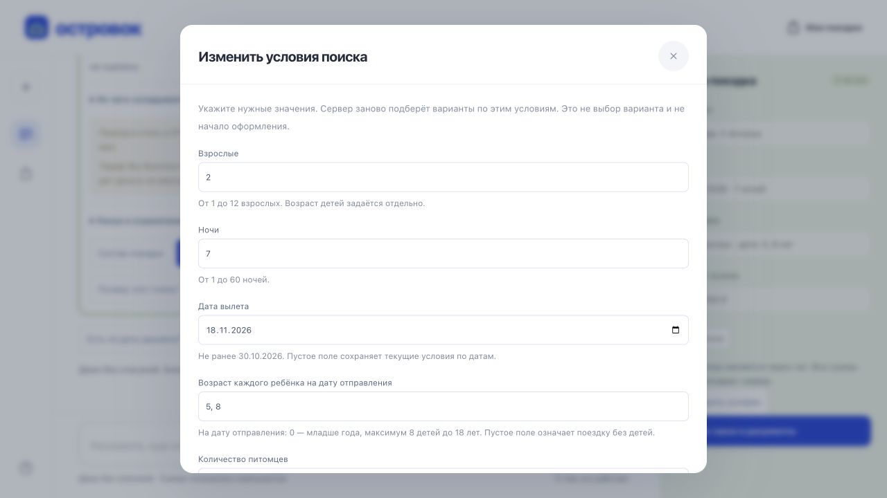
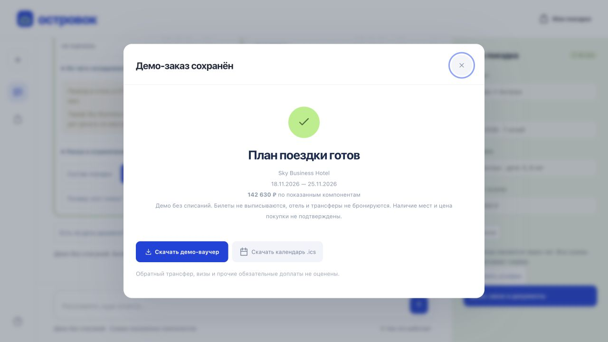

# Финальная полировка и расширенная репетиция

Дата: 29.10.2026. Код: `29fa6d16c79fbdbf4d6dd5b242629f0c028443f3`.
Отчёт дополняет [предыдущую репетицию](../judge-ui-rehearsal-2026-10-29/README.md),
не заменяя её исторические результаты. Оформление и оплата везде демонстрационные.

## Что изменилось

- Полная форма условий: взрослые, ночи, дата, возраст каждого ребёнка,
  количество питомцев и бюджет. Пустые детские возраста/бюджет и ноль питомцев
  явно снимают прежние ограничения; остальные пожелания сохраняются.
- Ошибки формы подписаны у поля; фокус возвращается к нему. Возраст задаётся
  на дату отправления. Одинаковые возраста детей не объединяются.
- У поездов отдельно указаны источник расписания и модельная цена. Синтетическое
  расписание и сохранённый ответ Яндекса различаются; наличие мест не обещается.
  Схема, примеры и record/replay-проверки обновлены вместе с DTO.
- Вопрос про детей спрашивает возраст каждого. Число питомцев 0–3 передаётся
  явно и правильно отражается в тексте и расчёте.
- Один постоянный `aria-live`-узел сообщает фазы и завершение; потоковые токены
  не пересоздают озвучивание всей переписки. Ошибки хранения и статусы сравнения
  не повторяются на каждом рендере. Плавная прокрутка учитывает reduced motion.

## Что проверено

| Проверка | Результат и границы |
|---|---|
| [Автоматические проверки](automated-checks.json) | **1644**: backend 1418, frontend 215, proxy 11; Ruff, форматирование и синтаксис проходят. |
| [Docker, три направления](docker-three-destinations.json) | Стандартный двухсервисный пакет без личных ключей: поиск, D7, D8, отказ/успех демо-оплаты, документы и границы доступа. Кэш сборки использован; новая холодная сборка не измерялась. |
| [Перезапуск Docker](docker-restart.json) | Все три заказа и документы сохранены после restart; это HTTP-проверка, не браузерная. |
| [Браузер](browser-checks.json) | Семья 2+2 → четыре путешественника → отказ/успех; снятие детских условий → два поля; валидация формы, клавиатура, подписи поездов, форма на 320 CSS px. |
| [Сайт по HTTPS](live-static.json) | Опубликованные файлы совпадают с репозиторием; без входа 401, с входом `/health` 200. |
| [Настоящая модель](live-rehearsal.json) | **18/18 ходов в четырёх новых сессиях**, 201,692 с суммарно; warning/error-событий нет. Анталья, семья в Дубае, Мальдивы и поезда: уточнения дат, бюджета, детей, питомца, отелей, отзывов и календаря. Выбор, оформление и оплата на сервере не выполнялись. |
| [Сохранность](live-preservation.json) | Прежние **8 заказов и 16 документов** неизменны; журнал уже принятых сообщений сохранён. |

Live-репетиция проверяет серверное состояние, типы событий и метки источников.
Она не является оценкой всех формулировок модели, LLM-извлечения профилей D7
из отзывов или полным повтором 49 браузерных сценариев. Локальная браузерная
репетиция использовала `fake`, серверная — быструю модель с низким reasoning.
Секреты, тела ответов, данные путешественников и ссылки доступа к заказам
в JSON-доказательства не включены.

[Поезда: два источника](train-sources.png) · [Форма на 320 CSS px](mobile-preferences.png)

## Что остаётся перед сдачей

1. Записать настоящее [демо-видео](../../../docs/video-recording.md), проверить
   публичную ссылку без аккаунта и добавить её в README. Ссылка пока не предоставлена.
2. После слияния PR #67 → #68 → #69 повторить стандартный запуск именно `main`.
   На момент фиксации этого отчёта проверен указанный выше коммит ветки.
3. Подтвердить у организаторов доступ жюри к приватному командному репозиторию.
   Доступ владельца через GitHub не подтверждает доступ неизвестной учётной записи жюри.
4. Физический телефон с экранной клавиатурой, настоящий 200% zoom и озвучивание
   VoiceOver/NVDA остаются непроверенными. Native-управление Mac было недоступно
   из-за блокировки; iframe-проверка и тесты статусов не заменяют эти шаги.

Тег `submission` **не создавался** по указанию владельца.

## Следующие улучшения для пользователя

Сначала: избранные варианты с повторным открытием и явной повторной проверкой
цены; кнопки «Дешевле», «Ближе к пляжу», «Только возвратный тариф»;
краткая структурированная сводка, какие условия и компоненты цены изменились.
Затем: компактная форма на широком экране, более удобный календарь гибких дат
и сравнение неоценённых расходов рядом с известной суммой. Общий вход между
вкладками требует отдельной пользовательской авторизации, а не публикации
внутренних ссылок доступа из session storage.
